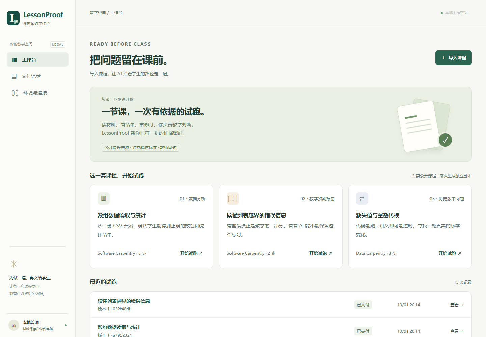
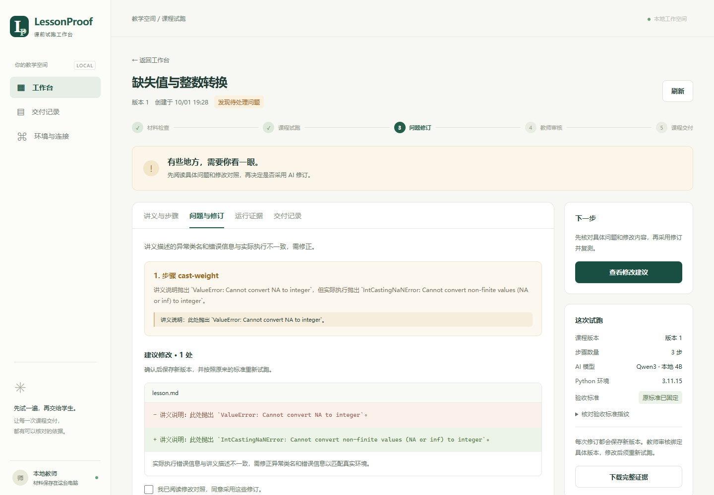

# LessonProof · 课前试跑

在实训课程交付给学生之前，按讲义实际操作、定位问题、审阅修订，并用运行证据完成验收。

## 当前版本

本地教师工作台：使用本机 Ollama 进行真实 AI 审阅，使用 WSL + bubblewrap 隔离执行公开课程，联网核对 GitHub 来源，审核后生成课程包、写入本地 Git 并回读。材料检查、执行验收和 AI 审阅分别呈现。



<details>
<summary>查看问题定位与修改对照</summary>



</details>

## 打开工作台

准备好下方的本地运行环境后，在项目根目录的 PowerShell 中运行：

```powershell
.\start.ps1
```

脚本会复用或启动本地 Ollama、启动工作台并打开 [http://127.0.0.1:8765](http://127.0.0.1:8765)。重复运行会复用正在运行的服务。输出日志在 `work/app.stdout.log` 和 `work/app.stderr.log`。

先按[验收操作指南](docs/ACCEPTANCE.md)体验“缺失值与整数转换”：确认步骤 → 实际试跑 → 审阅 AI 建议 → 修订复测 → 教师审核 → 课程交付。每次修订保留独立版本，验收标准保持固定。教师可记录 AI 误报的复核理由，但执行结果不符时不能直接放行。模型返回无效结构时会尝试纠正一次，两次调用均保存；仍不符合规则时保留失败证据。

**AgentArts 和远程教学平台尚未接入。** 当前交付终点是本地课程包与学生阅读页。AI 有误报和漏报的可能，最终交付需要教师判断；开发验证与人工试用分开记录，项目尚未提供课堂效率提升数据。

## 在另一台 Windows 电脑准备

需要 Python 3.11+、Git、uv、可用的 Ubuntu-24.04 WSL，以及 Ollama 中已准备好的 `qwen3:4b`。模型文件约 2.5 GB，由使用者按设备条件准备。

```powershell
python prepare_runtime.py
python verify_sandbox.py
.\start.ps1
```

准备脚本将核验过 SHA-256 的 Python 3.11.15 和 bubblewrap，以及课程依赖放入 `work/sandbox/`。支持标准库、NumPy 1.26.4、NumPy 1.26.4 + pandas 2.2.3 三种环境。

工作台只监听本机。隔离器提供独立网络/进程/挂载命名空间、只读课程输入、64 MiB 临时空间、30 秒 CPU/45 秒墙钟超时和 1536 MiB 进程地址空间限制。它用于已审阅的本地教学课程；这不是经过外部安全审计的多租户任意代码托管服务。

运行 `./stop.ps1` 可停止后台工作台，课程和证据会保留；进行中的试跑需要重新开始。如需在终端看服务输出，可先停止后台工作台，再运行 `python app.py --open`，使用 Ctrl+C 结束。

## 导入自己的课程

以任一 `benchmarks/` 目录为格式样板。ZIP 根目录包含 `course.json`、讲义、Notebook、独立验收标准、参考、许可和数据。修改后同步更新 `course.json` 的本地文件 SHA-256；来源部分保留上游原件的固定提交与哈希。工作台中的 AI 修订会自动登记新版本。

```powershell
Compress-Archive -Path .\benchmarks\numpy-data\* -DestinationPath .\work\numpy-data.zip
```

点击“导入课程”选择 ZIP。上限为上传 16 MiB、展开 24 MiB、单文件 8 MiB。当前适用于小型、按顺序执行、输出文本/JSON 的 Python 课程；图片、交互输入、联网安装和其他依赖组合需要扩展环境。自动来源核验支持 GitHub 固定提交的原始文件地址。

交付包仅含学生材料。继续检查时，以原课程包或证据包中的 `revisions/<版本>/` 为基础。

## 公开课程检查

需要 Python 3.10 或更新版本，检查器使用标准库。

```powershell
python check_course.py benchmarks/numpy-data
python check_course.py benchmarks/expected-index-error
python check_course.py benchmarks/pandas-error-version
```

三套样本分别覆盖正常数组分析、教学预期报错、历史讲义与 pandas 异常名称不一致。每套记录固定来源版本、文件校验值、许可和验收依据。

材料检查报告保存在 `work/checks/`，显示“可进入试跑”或具体材料问题；这个只读入口的执行状态始终为 `not_run`。真实执行与 AI 审阅通过工作台或 `verify_workflow.py` 另行产生证据。

先读[中文样本指南](benchmarks/README.md)，其中包含课程入口、检查范围和[人工试用记录表](benchmarks/manual_trials.csv)的填写方法。

## 原创开发回放

一节图书借阅课包含以下四个回放场景：

| 样例 | 预期判断 |
| --- | --- |
| 正常课程 | 读取借阅次数，得到 3 本书、10 次借阅，验收通过 |
| 数据列选错 | 程序能运行，但把库存数量当成借阅次数，验收失败 |
| 教学预期报错 | 演示非法整数转换，识别为预期行为，继续完成统计 |
| 修订后复验 | 修正数据列，按照原验收标准重新检查，通过 |

上述四个场景为项目自制开发样例。公开课程基准单独存放于 `benchmarks/`；用户试用数据在后续阶段采集。

## 运行

需要 Python 3.10 或更新版本，使用 Python 标准库。

```powershell
python demo.py
python -m unittest -v
python verify_sandbox.py
python verify_workflow.py
node --check web/app.js
node test_web.cjs
```

第一条命令会在 `work/runs/` 中创建本次运行目录，保存每个课程副本、验收标准、执行结果、修改对比，以及 `report.md` 和 `report.json`。重复执行会生成新的运行目录。

`demo.py` 是开发者回放工具，只提供仓库内置样例的回放入口；它使用独立 Python 进程，**不构成安全沙箱**。公开课程与上传课程通过工作台的 WSL + bubblewrap 环境隔离执行。

`verify_sandbox.py` 实测网络与主机路径隔离、输入只读、临时写入和超时终止。`verify_workflow.py` 实际调用 GitHub、WSL、Ollama 和 Git，验证三套公开课程及历史问题修订后的交付回读，结果保存到 `work/integration/`。开发验证不填入人工试用表。上传课程经材料检查和教师确认后，由工作台隔离运行。

## 已实现与下一步

| 能力 | 状态 |
| --- | --- |
| 原创课程与预先确定的验收标准 | 已提供 |
| 实际执行结果、预期报错、缺失步骤与结果不一致校验 | 已实现 |
| 样例修订对比及使用原标准复验 | 已提供开发回放 |
| 三套公开课程、历史修订证据与固定验收标准 | 已提供并完成隔离实跑 |
| 课程包文件、步骤、版本与路径检查 | 已实现，输出 JSON / Markdown |
| 人工试用记录表 | 已提供，待采集数据 |
| 按明确步骤执行、智能定位与提出修复 | 本地模型已实际验证，修订需教师确认 |
| 受控代码沙箱 | WSL + bubblewrap 已实际验证 |
| AgentArts | 待开发账号接入 |
| GitHub 与 Git | 已实现固定来源核验、本地课程归档和回读 |
| 远程教学平台 | 待授权接入及实测 |
| 教师审核工作台与本地交付回读 | 已实现；审核绑定课程版本 |

## 项目文件

- `app.py` / `web/`：Python 标准库本地服务与原生网页工作台。
- `workbench.py`：课程版本、审核、来源核验与交付流程。
- `ai_review.py`：本地模型调用、原文引用与修订范围验证。
- `runner.py` / `sandbox_linux.py` / `sandbox_worker.py`：隔离执行与宿主验收。

- `lessonproof.py`：验收执行记录，输出通过、失败或证据不足。
- `check_course.py`：只读检查课程包，输出材料准备状态。
- `demo.py`：构造并实际运行内置课程样例，保存完整证据。
- `test_lessonproof.py`：校验规则的回归检查。
- `examples/library/`：课程讲义、Notebook、数据与验收标准。
- `benchmarks/`：公开课程包、来源依据和人工试用记录表。
- [推进计划](docs/PLAN.md)：范围、里程碑、分工、评测与接入条件。
- [本轮验证记录](docs/VERIFICATION.md)：实际通过的检查与可复现入口。
- [赛事提交指南](docs/SUBMISSION.md)：对应赛题、当届日期、PDF 材料和需要补齐的试用证据。

浏览器验证入口 `verify_browser.js` 可通过 Playwright CLI 的 `run-code --filename verify_browser.js` 执行，需先打开本地工作台会话。它真实操作三套课程、调用本地模型与隔离器，生成独立课程副本并下载课程与证据包。使用方法见[验证记录](docs/VERIFICATION.md)。

## 常见问题

| 表现 | 处理 |
| --- | --- |
| 页面打不开 | 重新运行 `start.ps1`，查看 `work/app.stderr.log` 中的原因 |
| 页面提示会话已更新 | 服务重启后刷新浏览器 |
| 找不到 Ollama | 启动 Ollama，或执行 `start.ps1 -OllamaPath '完整程序路径'` |
| GitHub 来源未通过 | 在“运行证据”查看错误，检查 VPN/代理连通性后重新试跑 |
| 隔离环境失败 | 运行 `verify_sandbox.py`；缺少文件时运行 `prepare_runtime.py` |
| AI 报错或提出无效修订 | 记录已保留，核对原因后重新试跑；不能直接交付 |
| AI 把一致内容列成问题 | 展开“教师复核”，核对证据并填写无需修改的理由 |
| 文件在工作台外变化 | 将修改后的完整课程包重新导入，以新版本开始 |
